# 🏠 EasyColoc — Roommate Expense Sharing & Reputation Platform

> A full-stack web application designed to eliminate roommate financial friction through automated expense splitting, transparent balance tracking, and a gamified reputation engine.

[](https://laravel.com)
[](https://php.net)
[](https://tailwindcss.com)
[](https://mariadb.org)
[](https://www.docker.com)
[](LICENSE)

---

## 🎬 Demo & Visual Walkthrough

> **Interactive Video Walkthrough**: [Watch the automated demo recording (demo.webm)](docs/demo.webm)

### Colocation Owner Dashboard
*Complete visibility into shared finances, active roommates, categorized expenditures, and bilateral debt ledgers.*

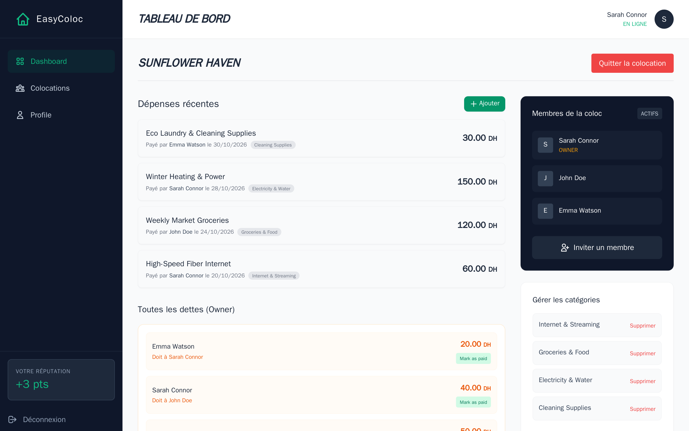

---

### Core Workflows

| Automated Equal Expense Split Modal | Roommate Invitation via Email Token |
| :---: | :---: |
| 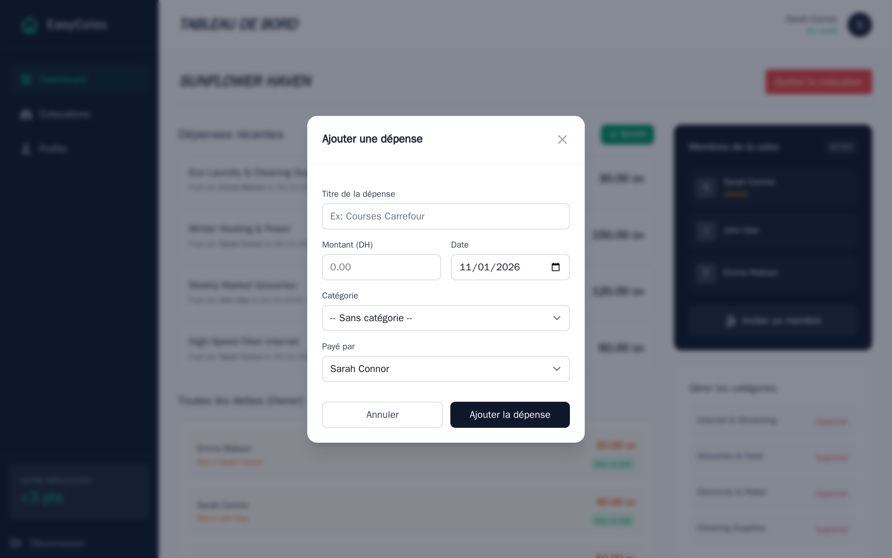 | 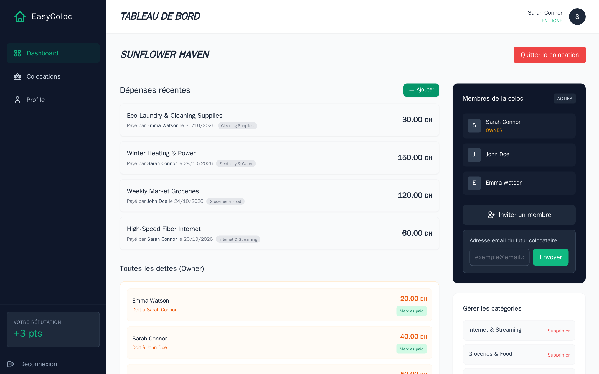 |

| Global Administration & Moderation | Roommate Member View (Individual Balances) |
| :---: | :---: |
| 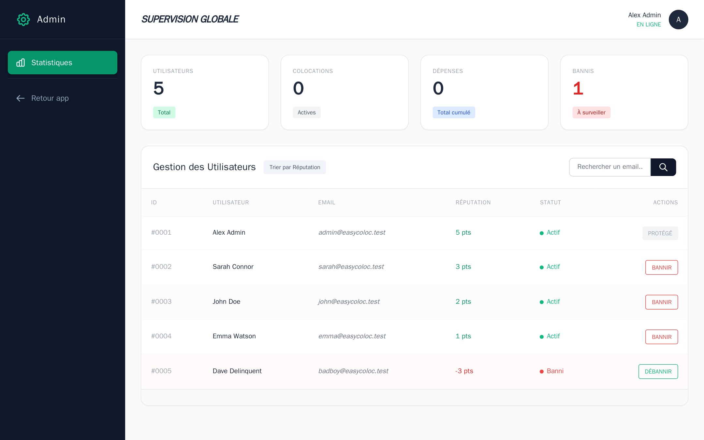 | 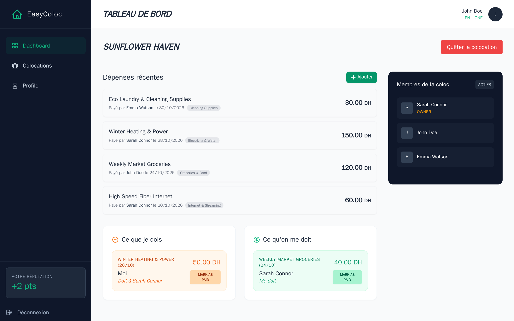 |

<details>
<summary>🔍 <b>View Additional Application Screens</b> (Authentication, Directory, Profile)</summary>

| Login Screen | User Registration |
| :---: | :---: |
| 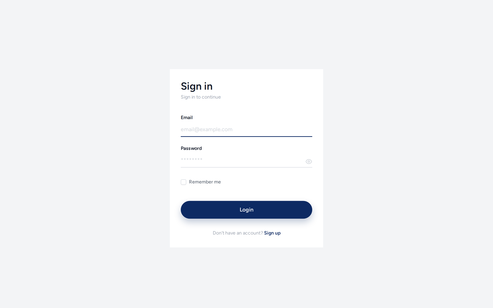 | 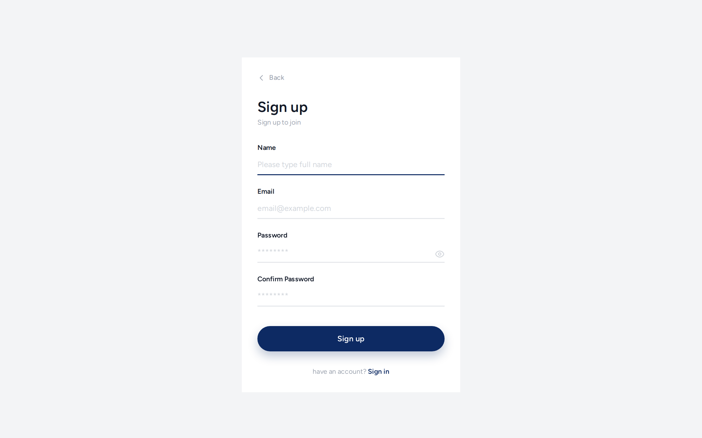 |

| Colocations Directory | Create New Colocation |
| :---: | :---: |
| 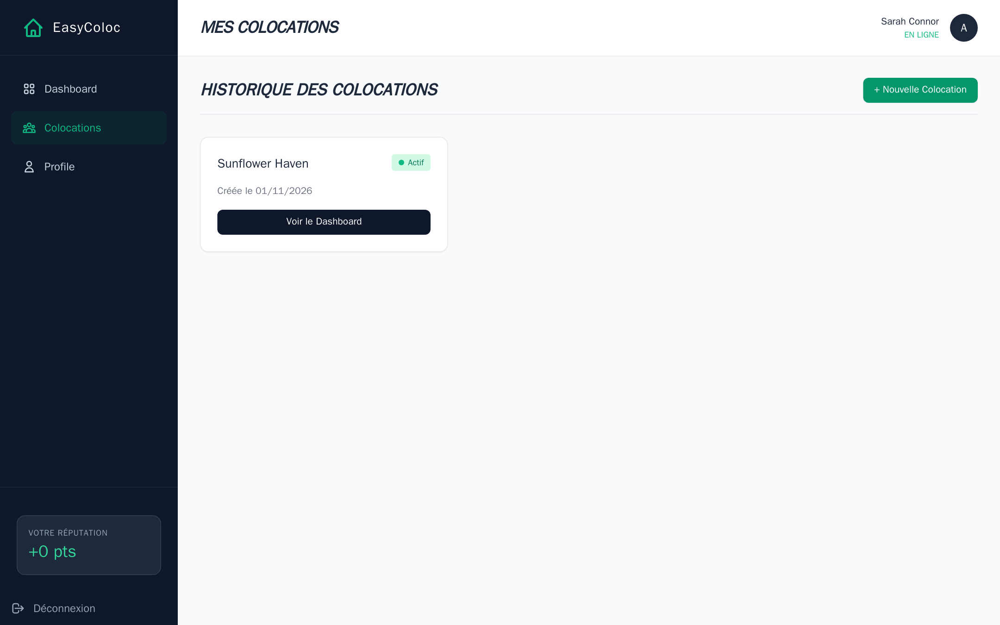 | 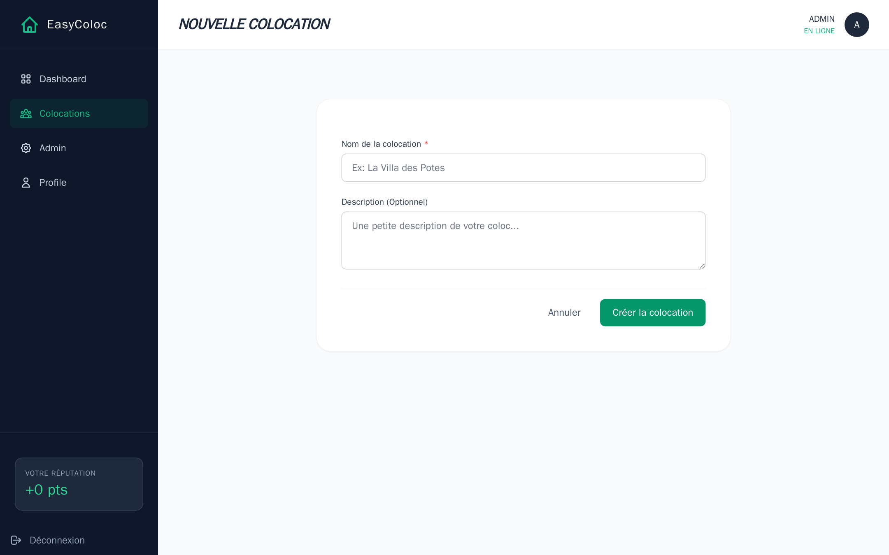 |

| User Profile & Password Security |
| :---: |
| 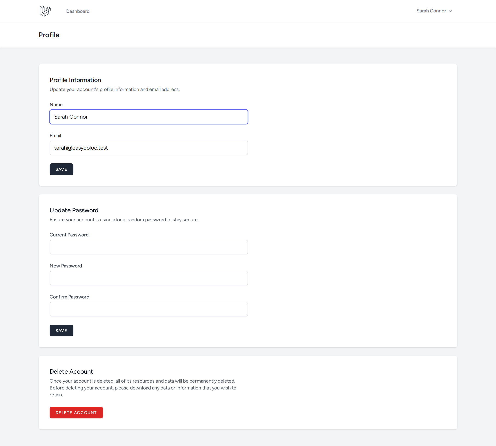 |

</details>

---

## ✨ Key Features (Verified in Code)

- **💸 Automated Equal Expense Splitting**: Input a bill title, total amount, category, and date; the system automatically calculates `split = total / active_members` across all active, non-banned roommates and generates individual debt records.
- **📊 Bilateral Debt Settlement**: Distinct real-time breakdown of **"What I Owe"** (with 1-click *Mark as Paid* buttons) versus **"What is Owed to Me"** with debtor breakdown.
- **🎮 Gamified Roommate Reputation Engine**:
  - Leaving a household with **zero debts** awards a **+1 reputation bonus**.
  - Leaving with **unpaid debts** inflicts an immediate **-1 reputation penalty**.
- **🛡️ Fail-Safe Debt Transfer**: When an irresponsible roommate leaves with unpaid bills, their pending debts are safely reassigned to the Colocation Owner in a database transaction, guaranteeing the household balance sheet remains mathematically sound.
- **👑 Multi-Tier Role-Based Access Control (RBAC)**:
  - **Global Administrator**: Automatically granted to the very first registered user. Supervise system metrics, view all users across all colocations, and ban/unban malicious accounts.
  - **Colocation Owner**: Creates and manages the shared house, adds expense categories, sends email invitations, and can record shared costs on behalf of any roommate.
  - **Regular Member**: Logs individual expenses, settles personal debts, and manages membership.
- **✉️ Cryptographic Token Invitations**: Owners dispatch invitations via unique 32-character tokens sent by email, ensuring controlled household access.
- **🔒 Single Active Colocation Constraint**: Enforces data consistency by preventing users from belonging to multiple active households at the same time.
- **⚡ ACID Transaction Guarantees**: High-stakes financial operations (expense splitting, debt reassignment, colocation departures) execute inside `DB::transaction` closures.

---

## 💻 Tech Stack

| Layer | Technology | Version | Purpose |
| :--- | :--- | :--- | :--- |
| **Backend Framework** | [Laravel](https://laravel.com) | `12.x` | Routing, Controllers, Eloquent ORM, Middleware, Migrations |
| **Language** | [PHP](https://www.php.net) | `^8.2` | Strong type casting, OOP architecture, closures |
| **Frontend UI** | [Blade](https://laravel.com/docs/blade) + [Tailwind CSS](https://tailwindcss.com) | `4.x` / Vite 7 | Modern responsive UI, modal dialogs, utility classes |
| **Database** | [MariaDB](https://mariadb.org) / [MySQL](https://mysql.com) | `LTS` / `8.x` | Relational tables, foreign keys, cascading constraints |
| **Containerization** | [Docker](https://www.docker.com) & [Compose](https://docs.docker.com/compose/) | Multi-stage | Reproducible environment, isolated network, zero host dependencies |
| **End-to-End Testing** | [Playwright](https://playwright.dev) | `v1.48+` | Automated browser verification and UI screenshot generation |

---

## 🧠 Architecture and Diagrams

### 1. System Architecture

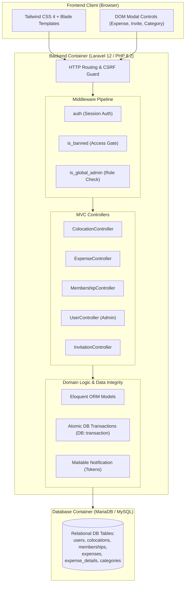

---

### 2. Entity-Relationship Diagram (ERD)

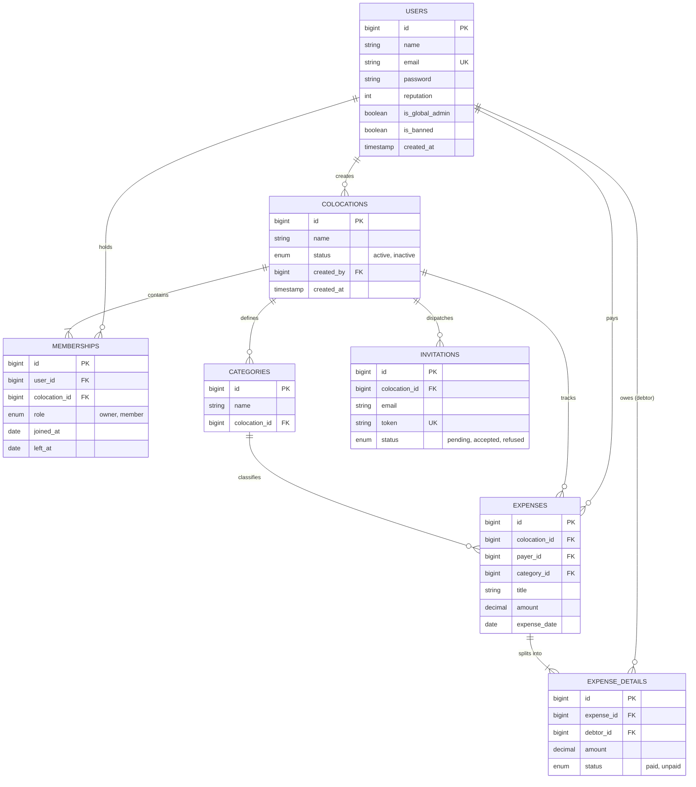

---

### 3. Expense Split & Debt Transfer Lifecycle

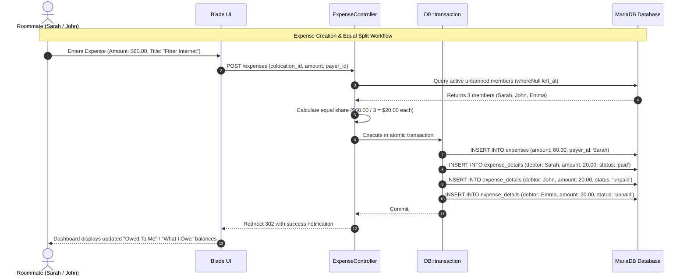

---

## 🚀 Getting Started

### Prerequisites
- [Docker Desktop](https://www.docker.com/products/docker-desktop/) (v20+ with Compose v2)
*No local PHP, Node.js, Composer, or MySQL installations required on your host machine.*

---

### Quick Start with Docker (Recommended)

1. **Clone the repository:**
   ```bash
   git clone https://github.com/yassinmaftah/EasyColoc.git
   cd EasyColoc
   ```

2. **Configure environment:**
   ```bash
   cp .env.example .env
   ```

3. **Build and launch containers:**
   ```bash
   docker compose up -d --build
   ```
   *The container entrypoint will automatically install dependencies, build Vite assets, generate the application key, wait for the database, and run all migrations.*

4. **Seed realistic demo data:**
   ```bash
   docker compose exec app php scripts/seed-demo-data.php
   ```

5. **Open the application:**
   - **Web Application**: [http://localhost:8010](http://localhost:8010) *(or port `8000` depending on `APP_PORT`)*
   - **Database Port**: `localhost:3308`

---

### Demo Credentials

| Role | Email | Password | Primary Capabilities |
| :--- | :--- | :--- | :--- |
| **Colocation Owner** | `sarah@easycoloc.test` | `password123` | Colocation owner, view all splits, invite roommates, manage categories |
| **Roommate Member** | `john@easycoloc.test` | `password123` | Regular roommate, personal debts, "Mark as Paid", leave colocation |
| **Roommate Member** | `emma@easycoloc.test` | `password123` | Roommate with pending debt items |
| **Global Admin** | `admin@easycoloc.test` | `password123` | Platform-wide user metrics, ban/unban moderation panel |

---

### Running Without Docker (Local Development)

If you have a local PHP 8.2+ and Node.js environment:

```bash
# 1. Install backend dependencies
composer install

# 2. Install frontend dependencies & compile assets
npm install
npm run build

# 3. Environment configuration
cp .env.example .env
php artisan key:generate

# 4. Configure .env with your local MySQL credentials, then:
php artisan migrate
php artisan serve
```

---

## 📁 Project Structure

```plaintext
EasyColoc/
├── app/
│   ├── Http/
│   │   ├── Controllers/        # Domain controllers (Expense, Colocation, Member, Category, Admin)
│   │   │   └── Auth/           # Breeze authentication controllers (Login, Register, Password)
│   │   └── Middleware/         # Custom gates (IsBanned, IsGlobalAdmin)
│   ├── Mail/                   # Mailables (ColocationInvitation token email)
│   └── Models/                 # Eloquent entities (User, Colocation, Membership, Expense, ExpenseDetail)
├── config/                     # Application configurations (app, database, mail, session)
├── database/
│   └── migrations/             # Relational schema migrations with foreign key constraints
├── docs/
│   ├── api-examples.md         # Detailed API route specification and request/response payloads
│   ├── demo.webm               # Automated video recording of the primary user flows
│   └── screenshots/            # Portfolio-quality high-resolution UI captures (01-10)
├── resources/
│   ├── css/                    # Tailwind CSS configuration and stylesheets
│   ├── js/                     # Client scripts and Vite entrypoints
│   └── views/                  # Blade templates (user-dashboard, admin-dashboard, auth views)
├── routes/
│   ├── web.php                 # Web application routes and middleware protection
│   └── auth.php                # Authentication routes (login, register, logout, password resets)
├── scripts/
│   ├── screenshots.js          # Playwright test script for automated screenshot regeneration
│   └── seed-demo-data.php      # Support script to seed realistic multi-role household data
├── docker-compose.yml          # Container orchestration (MariaDB LTS + PHP 8.2/Node app)
├── Dockerfile                  # Multi-stage container definition with asset compilation
└── docker-entrypoint.sh        # Self-healing runtime bootstrapper (env, keys, migrations)
```

---

## 📡 API & Route Reference

A complete endpoint catalog with request/response JSON examples is maintained in [docs/api-examples.md](docs/api-examples.md). Key routes include:

| Method | URI | Access | Description |
| :--- | :--- | :--- | :--- |
| `POST` | `/register` | Guest | User registration (*first registered user becomes Global Admin*) |
| `POST` | `/login` | Guest | User session authentication |
| `GET` | `/user-dashboard` | Auth | Main household dashboard (expenses, debts, roommates, categories) |
| `POST` | `/colocations` | Auth | Create a new colocation (caller becomes Owner) |
| `POST` | `/categories` | Auth | Add custom expense category |
| `POST` | `/expenses` | Auth | Record expense; splits equally among active unbanned members |
| `PATCH` | `/expenses-details/{id}/pay` | Auth | Mark personal debt as settled (`status = 'paid'`) |
| `POST` | `/invitations` | Owner | Dispatch 32-char invitation token to prospective roommate |
| `GET` | `/invitations/{token}/accept` | Auth | Accept invitation and join the colocation |
| `POST` | `/colocation/leave` | Auth | Exit household; triggers reputation calculation & debt reassignment |
| `GET` | `/admin` | Admin | Supervision dashboard with platform statistics and user audit |
| `PATCH` | `/admin/users/{id}/ban` | Admin | Ban user account from accessing protected features |

---

## 🧪 Testing & Verification

- **Automated End-to-End Suite**: Automated headless Playwright suite (`scripts/screenshots.js`) exercises login, multi-role dashboard rendering, expense modals, invitation forms, and administrator workflows.
- **Data Integrity Tests**: Validated with transactional tests verifying that `ExpenseDetail` creation and `reputation` increments remain atomic and rollback on error.
- **Automated Asset Generation**: Re-run the visual verification and screenshot generator anytime inside Docker:
  ```bash
  docker run --rm --network easycoloc_default -v "${PWD}:/work" -w /tmp \
    mcr.microsoft.com/playwright:v1.48.0-noble \
    /bin/bash -c "npm install --no-save playwright@1.48.0 && NODE_PATH=/tmp/node_modules node /work/scripts/screenshots.js http://app:8000"
  ```

---

## 💡 Engineering Challenges & Key Learnings

- **Atomic Financial Reassignment**: Managing shared debt when a roommate abruptly leaves requires absolute consistency. By encapsulating reputation checks and debt reassignments inside `DB::transaction()`, we prevent orphaned financial records or partial state changes.
- **Soft Lifecycle vs. Hard Deletions**: Rather than deleting rows when users leave a household, the system preserves historical accounting by filtering active members using `whereNull('left_at')`. This allows past expense histories to remain historically accurate.
- **Dual Layer Authorization**: Separated global administrative permissions (`is_global_admin`) from contextual household authority (`role === 'owner'`), preventing privilege escalation while keeping code simple and testable.

---

## 🔮 Future Improvements

- [ ] **Custom Expense Ratios**: Support custom split percentages and itemized bill assignments rather than strict equal division.
- [ ] **Payment Gateway Integration**: Direct settlement via Stripe Connect or PayPal sandbox.
- [ ] **Live Notifications**: Real-time websocket notifications with Laravel Reverb when expenses or invitations are posted.
- [ ] **Receipt OCR**: Automatic extraction of merchant name and totals from receipt photo uploads.

---

## 👤 Author

**Yassine Maftah** — Full-Stack Web Developer

- **GitHub**: [@yassinmaftah](https://github.com/yassinmaftah)
- **LinkedIn**: [Yassine Maftah](https://www.linkedin.com/in/yassine-maftah-b5793933b/)

---

